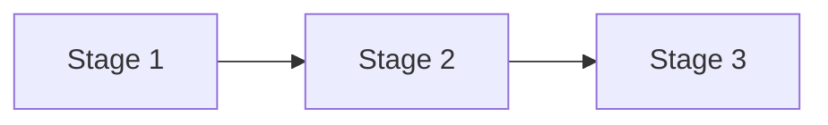
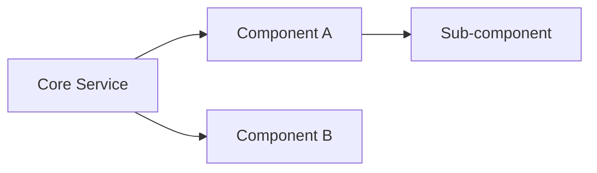
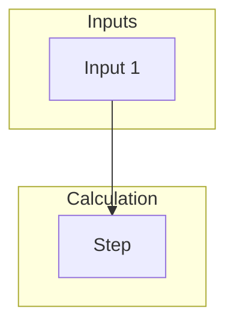

# Map Page Template

Every wiki/maps/{Topic}.md must follow this structure.

## Filename convention

- `wiki/maps/{Topic} 全貌.md` (in Chinese context)
- `wiki/maps/{Topic} Overview.md` (in English context)

## Frontmatter

```yaml
---
title: "Topic 全貌"
type: map
tags: [topic, MOC, map]
source:
  - "[[原始文件]]"
created: YYYY-MM-DD
updated: YYYY-MM-DD
---
```

## Body structure

### 1. Lead paragraph (blockquote)

ONE sentence describing the map's coverage:

```markdown
> 由 LLM 編譯的訂單系統概念圖，透過 wiki/entities/ 28 個原子化頁面交叉連結。
```

### 2. Mermaid flowchart(s)

Pick 1-3 diagrams that show different facets:

#### Process diagram (if applicable)



#### Dependency graph



#### Concept network



### 3. Entity index by sub-category

Group all entities with 1-line descriptions:

```markdown
## 服務（核心引擎）

- [[PricingService]] — 核心公式單一來源
- [[OrderValidator]] — 提交驗證

## 規則

- [[折扣規則]] — 五級折扣區間
- [[折扣上限]] — 限制最高折扣條件
```

### 4. Cross-topic relationships

Highlight which entity is the hub:

```markdown
## 跨主題關係

[[PricingService]] 是樞紐——被 [[OrderValidator]]、[[BillingService]]、[[DiscountReviewService]] 共同消費。

[[折扣上限]] 影響：[[OrderValidator]]、[[促銷標記 PromoFlag]]、...
```

### 5. Cross-knowledge-base links

Link to OTHER maps:

```markdown
## 跨知識庫連結

- [[wiki/maps/Claude 學習地圖]] — Claude 工具地圖
- [[40-Resources/Karpathy LLM Wiki 模式]] — 範式來源
```

### 6. Source documentation

```markdown
## 相關深入文件

完整訂單系統規格（25 份）：[[40-Resources/訂單系統/README]]
```

## Anti-patterns

❌ Map without any mermaid diagram (text-only = just a duplicate of index.md)  
❌ Map listing only entities without showing relationships  
❌ Mermaid diagrams with too many nodes (>15 = unreadable). Split into multiple diagrams.  
❌ Forgetting cross-topic links to other maps
