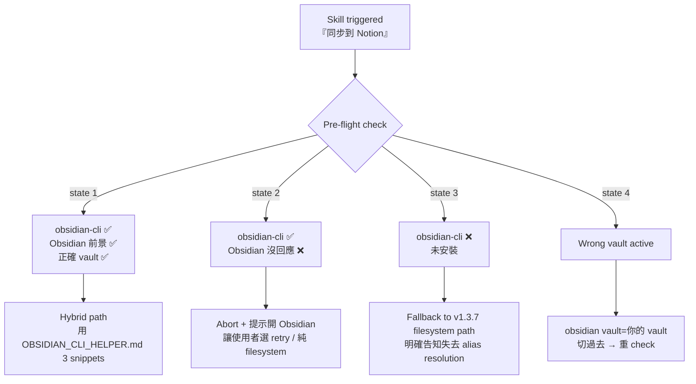

# CLI Fallback Strategy for wiki-notion-sync v1.3.8

> 當 [[Obsidian CLI]] 不可用時，wiki-notion-sync 怎麼安全降級回 v1.3.7 純 filesystem path——而不是直接失敗。

## 為什麼要 fallback 而不是 abort

| 對立面 | 為什麼 |
|--------|------|
| ❌ Abort | 使用者可能在沒 Obsidian 的環境（CI / SSH / Docker）想推；強制 abort = 卡死工作流 |
| ❌ 假設總是 hybrid | Obsidian 雖然多數時候開著但**不能假設**；遇到 macOS 重開機 / Sync 同步中 / 偶發 IPC 故障時要能繼續 |
| ✅ Detect → Decide → Fallback | 主路徑 hybrid（fast / accurate），失敗自動降級到 known-good v1.3.7 |

**核心信念**：v1.3.7 的 filesystem-only 路徑經 5 個月實戰驗證，是 known-good baseline。Hybrid 是優化，不是替代。

---

## Decision tree



---

## 4 種狀態 + 應對

### State 1：Hybrid 可用（happy path）

**判定**：

```bash
which obsidian > /dev/null && \
  obsidian vault > /dev/null 2>&1 && \
  [ "$(obsidian vault | grep '^name' | awk '{print $2}')" = "$VAULT_NAME" ]
```

**動作**：照 [[Notion Sync Hybrid 架構]] §Spec 走 v1.3.8 hybrid path（用 [`OBSIDIAN_CLI_HELPER.md`](OBSIDIAN_CLI_HELPER.md) 的 Snippet 1+2）。

---

### State 2：CLI 裝了但 Obsidian 沒回應

**判定**：

```bash
which obsidian > /dev/null && \
  ! obsidian vault > /dev/null 2>&1
```

**動作**：**ASK 使用者**（不要靜默降級）：

```
⚠️ obsidian-cli 已裝，但 Obsidian 沒回應（可能沒開 / 沒在前景 / Sync 同步中）。

選一個：
[1] 開 Obsidian 後再 retry（推薦——保留 alias resolution）
[2] 走 v1.3.7 純 filesystem path（有 alias 邊角風險，本 vault 實測 93 個 alias 會漏解）
[3] 取消
```

理由：State 2 通常是**暫時**情況（使用者忘了開 Obsidian），ask 比 silent 降級對使用者更好——避免他發現 Notion 內容奇怪後才 debug。

---

### State 3：CLI 沒裝（最低層 fallback）

**判定**：

```bash
! which obsidian > /dev/null 2>&1
```

**動作**：直接走 v1.3.7 純 filesystem path，**明確告知失去什麼**：

```
ℹ️ obsidian-cli 未安裝，使用 v1.3.7 純 filesystem 路徑。

失去的能力：
- ❌ alias 自動解（本 vault 93 個 alias 會被當缺失連結，留 bold placeholder）
- ❌ NFC/NFD 自動 normalize（macOS 含變音符 filename 可能漏）
- ❌ stale push 檢查（推到 Notion 的可能跟 Obsidian 端有窗口差）

要恢復這些能力：brew install obsidian-cli && 重跑 skill。

繼續 v1.3.7 模式？[Y/n]
```

→ 使用者明確 Y 才繼續。N 就 abort。

---

### State 4：Wrong vault active（自動修復）

**判定**：

```bash
which obsidian > /dev/null && \
  obsidian vault > /dev/null 2>&1 && \
  [ "$(obsidian vault | grep '^name' | awk '{print $2}')" != "$VAULT_NAME" ]
```

**動作**：嘗試切 vault（safe，純 IPC）：

```bash
obsidian vault="$VAULT_NAME" vault > /dev/null
```

如果成功 → 回到 State 1 重 check
如果失敗（vault 不存在 / 沒授權）→ 降級到 State 2 處理（ask）

---

## v1.3.7 fallback path（State 3 走的路）

完整步驟同 v1.3.7 SKILL.md（沒改）：

1. `Glob wiki/entities/**/*.md`
2. `Read` 每個檔 → 自寫 YAML parse 拿 frontmatter
3. regex 抓 `[[X]]` → split basename → 對 entity file 比對是否存在
4. 建 buckets / id_map
5. Pass 1 create_pages（粗體 placeholder）
6. Pass 2 update_pages（解 placeholder → real link，用 step 3 的 regex 結果）

**已知限制**（hybrid 解、fallback 不解）：

- alias 漏：`[[BASB]]`、`[[Karpathy]]` 等 93 個 alias 都當 missing
- NFC/NFD：含變音符 filename 可能比對失敗
- 跨 domain ref 在 Pass 1 時 id_map 還沒建完 → 留 bold

---

## Edge cases（少數但要記）

### Sync 同步中（Obsidian Sync）

`metadataCache` 可能不完整。

**判定**：

```bash
obsidian sync:status 2>&1 | grep -q "syncing" && echo "wait"
```

**動作**：等 idle 或讓使用者明確「sync 完了再推」。

### Obsidian 版本太舊（< 1.9）

`app.metadataCache.resolvedLinks` 在 1.9+ 才穩定。1.8 之前 schema 會不太一樣。

**判定**：

```bash
obsidian eval code='app.metadataCache.resolvedLinks ? "ok" : "missing"' | grep -q ok
```

不 ok → 走 State 3（純 filesystem）並提醒升級 Obsidian。

### eval timeout（超大 vault）

≥ 1000 entity 跑 Snippet 1 可能 truncate。

**判定**：解出來的 JSON parse 失敗。

**動作**：走 [`OBSIDIAN_CLI_HELPER.md`](OBSIDIAN_CLI_HELPER.md) §Big-vault chunk mode。

### Plugin 升級 break API

`app.metadataCache` schema 改動（Obsidian 大版本）。

**判定**：snippet 1 的某個 field 是 undefined。

**動作**：報錯 + 走 State 3 + 提示檢查 plugin 是否相容。

---

## Detection 流程（pseudocode）

實際 SKILL.md step 0 跑的順序：

```python
def determine_path():
    # State 3 check（最快）
    if not shutil.which("obsidian"):
        return ask_continue_v137_filesystem()  # 純 filesystem fallback

    # State 2 check
    try:
        result = subprocess.run(["obsidian", "vault"], capture_output=True, timeout=5)
        if result.returncode != 0:
            return ask_user_state2()  # CLI ok / Obsidian not responding
    except subprocess.TimeoutExpired:
        return ask_user_state2()

    # State 4 check（自動修復）
    current_vault = parse_vault_name(result.stdout)
    if current_vault != EXPECTED_VAULT:
        switch_result = subprocess.run(["obsidian", f"vault={EXPECTED_VAULT}", "vault"])
        if switch_result.returncode != 0:
            return ask_user_state2()

    # Edge: Obsidian 太舊
    api_check = run_eval('app.metadataCache.resolvedLinks ? "ok" : "missing"')
    if api_check != "ok":
        return ask_continue_v137_filesystem()

    # Edge: Sync 同步中
    if is_syncing():
        return wait_for_sync_idle()

    # Happy path
    return run_hybrid_path()
```

---

## Verification matrix

確認 v1.3.8 SKILL 在 4 種狀態行為對：

| 模擬情境 | 預期行為 |
|---------|---------|
| 正常開 Obsidian | State 1：hybrid path 跑（log 顯示 `Hybrid mode active`）|
| 關 Obsidian | State 2：ask 出現 |
| `brew uninstall obsidian-cli`（測試環境）| State 3：v1.3.7 fallback ask 出現 |
| 切到別的 vault | State 4：自動 `obsidian vault="$VAULT_NAME" vault`，hybrid 繼續 |
| Obsidian 大版本升級壞 API | Edge：報錯 + fallback 提示 |
| 1500+ entity vault | Edge：chunk mode |

實作時逐個 check（手動或寫 test script）。

---

## See also

- [`OBSIDIAN_CLI_HELPER.md`](OBSIDIAN_CLI_HELPER.md) — State 1 用的 eval snippets
- [`LINK_CONVERSION.md`](LINK_CONVERSION.md) — 兩條路徑都用的 wiki-link → Notion link 轉換規則
- vault entity：[[Notion Sync Hybrid 架構]] §反模式 — 設計考量
- vault entity：[[Obsidian CLI]] — 通用文件
