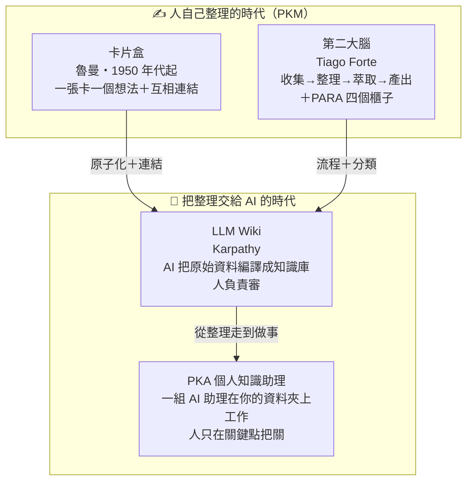

# 01 方法論總覽：卡片盒、第二大腦、LLM Wiki、PKA

> 📌 **這篇管**：四種做法各是什麼、解決什麼問題、差在哪、怎麼搭配｜**不管**：AI 助理怎麼分工（看 [[02 PKM與PKA架構]]）、怎麼開始用這個 vault（看 [[03 Vault建置與上手]]）

## 先講結論：四種做法回答四個不同的問題

| 做法 | 回答的問題 | 一句話 | 誰提出 |
|---|---|---|---|
| **卡片盒**（Zettelkasten） | **怎麼思考？** | 一張卡片只寫一個想法，卡片之間互相連結，想法會自己長出新想法 | 德國社會學家 Niklas Luhmann（魯曼） |
| **第二大腦**（Building a Second Brain） | **怎麼工作？** | 把資訊照「收集 → 整理 → 萃取 → 產出」四步走，用 PARA 四個櫃子分類 | Tiago Forte |
| **LLM Wiki** | **誰來整理？** | 原始資料丟進去，由 AI 把它「編譯」成一套互相連結的知識庫，人負責審 | Andrej Karpathy |
| **PKA 個人知識助理** | **誰來做事？** | 不只整理，連收集、查詢、產出都交給一組 AI 助理，人只在關鍵點把關 | Tom（ICOR） |

前兩種是**人自己整理**的時代；後兩種是**把整理、甚至整個流程交給 AI** 的時代。它們不是互相取代，而是一層疊一層——這個 vault 就是四種疊在一起用。

## 1. 卡片盒：怎麼思考

![[01-Niklas Luhmann.jpg|170]]

> 魯曼（1989 年，聖加侖大學檔案館，CC BY-SA 4.0）。

**故事**：魯曼一生用約 90,000 張卡片，寫出 70 多本書、400 多篇論文。他的祕訣不是記得多，而是**寫筆記的過程本身就是寫作的過程**。

| 卡片 | 用途 |
|---|---|
| **靈感筆記** | 隨手記下一閃而過的想法，之後再處理 |
| **文獻筆記** | 讀書、看影片時，用簡短條列記重點 |
| **永久筆記** | 用**自己的話**寫成一個完整的想法——這是卡片盒的核心 |
| **索引卡片** | 讓你之後找得回來的入口 |

**關鍵觀念**：一張卡只放一個想法（原子化），每寫一張新卡就想「它跟哪幾張舊卡有關」並連起來。卡片夠多之後，寫文章時不是從白紙開始，而是把相關的卡片撈出來排一排。

> 在這個 vault 裡：`wiki/entities/` 的每一頁就是一張「永久筆記」，`10-Notes/` 放你自己寫的想法。

## 2. 第二大腦：怎麼工作

**核心觀念**：大腦適合產生想法，不適合儲存想法。把值得留下的東西交給外部系統，注意力才能留給創造。

**CODE 四步驟**：

| 步驟 | 做什麼 | 常見失敗 |
|---|---|---|
| **收集**（Capture） | 只留真的有共鳴、未來可能用到的 | 什麼都存，倉庫變垃圾場 |
| **整理**（Organize） | 依「要拿來做什麼」分類，而不是依主題 | 整理得很漂亮，但從來不用 |
| **萃取**（Distill） | 累進式摘要：每次回看就再畫一次重點，一層層濃縮 | 跳過這步，要用時又得重讀一次 |
| **產出**（Express） | 寫成文章、簡報、決策——知識要被用出來才算數 | 一直收、一直整理，從不產出 |

**PARA 四個櫃子**：

| 櫃子 | 放什麼 | 判斷方式 |
|---|---|---|
| **專案**（Projects） | 有目標、有截止日的事 | 這件事有「做完」的一天嗎？有 → 專案 |
| **領域**（Areas） | 需要一直照顧、沒有終點的責任 | 健康、財務、團隊管理 |
| **資源**（Resources） | 未來可能用到的主題參考 | 感興趣、但現在沒在用 |
| **封存**（Archives） | 目前用不到，但可能要回頭查 | 完成的專案、退場的領域 |

> 在這個 vault 裡：`20-Projects/`～`50-Archive/` 就是 PARA 四個櫃子，`00-Inbox/` 是收集的入口。

## 3. 卡片盒 vs 第二大腦：不是二選一

| | 卡片盒 | 第二大腦 |
|---|---|---|
| 解決 | **怎麼想**（結構） | **怎麼做**（流程） |
| 基本單位 | 一張卡一個想法 | 一則筆記，不限大小 |
| 分類 | 編號＋連結 | PARA 四個櫃子 |
| 適合 | 深度寫作、研究 | 一般知識工作 |

**最好的做法是疊起來用**：用第二大腦管「流程和分類」，在萃取這一步用卡片盒的方法把重點寫成一個個原子概念並連起來。

## 4. LLM Wiki：誰來整理

前兩種做法最大的問題是：**整理要花很多時間，人通常撐不久**。

![[02-Andrej Karpathy.jpg|150]]

> Andrej Karpathy（Gladwin Analytics 攝，CC BY 3.0）。OpenAI 創始成員、前 Tesla AI 總監；2026-04 公開他用 AI 維護個人知識庫的做法。

> "Obsidian is the IDE; the LLM is the programmer; the wiki is the codebase."
>
> 繁中：「Obsidian 是開發工具；LLM 是程式設計師；wiki 是程式碼庫。」

意思是：**你把原始資料（文章、影片逐字稿、會議紀錄）丟進收件匣，由 AI 讀完、拆成一個個概念頁、跟既有的頁面連起來、更新索引和日誌**。人負責決定要不要收、審 AI 寫得對不對。

| 跟傳統做法比 | 傳統 PKM | LLM Wiki |
|---|---|---|
| 誰拆概念、建連結 | 人 | AI |
| 每次問問題 | 人去翻筆記 | AI 先讀知識庫再回答，附來源 |
| 知識庫會不會越來越亂 | 會，除非一直花時間整理 | AI 定期健康檢查：找孤兒頁、矛盾、缺的概念 |
| 跟「把文件丟給 AI 搜尋」差在哪 | — | 不是每次從原始文件找答案，而是**事先編譯好、持續維護**一套知識庫 |

> 在這個 vault 裡：`CLAUDE.md` 就是給 AI 的工作說明書，7 個 wiki 技能負責收進來（ingest）、健康檢查（lint）、查詢（query）等動作。

## 5. PKA 個人知識助理：誰來做事

再往前一步：不只整理，**收集、查詢、產出都交給一組 AI 助理**，每個助理有自己的職責，人只在關鍵點把關。

| | PKM（個人知識管理） | PKA（個人知識助理） |
|---|---|---|
| 主動方 | 使用者自己整理 | AI 助理整理 |
| 結構 | 軟體預設的格式（例如 Notion 的資料庫） | 你自己的資料夾＋純文字檔 |
| 換工具的成本 | 高，格式被鎖住 | 低，純文字檔換哪個 AI 都能讀 |
| 怎麼客製 | 受限於軟體功能 | 用自然語言告訴 AI 怎麼做 |

**三個核心信念**：資料留在自己電腦上；AI 配合你，不是你配合軟體；工具隨時可換，知識不會跟著消失。

## 6. 讀完想一想

1. 你現在的筆記，是「收了很多、很少用」，還是「用得到、但找不到」？前者缺萃取與產出，後者缺整理與連結。
2. 你的資料放在哪裡？如果明天那個軟體不能用了，你的筆記還在嗎？
3. 哪些整理工作你願意交給 AI？哪些一定要自己判斷？（提示：看 [[02 PKM與PKA架構]] 裡「人在哪裡把關」）

---

← 回到 [[40-Resources/PKM入門/README|PKM 入門]]｜下一篇：[[02 PKM與PKA架構]]
