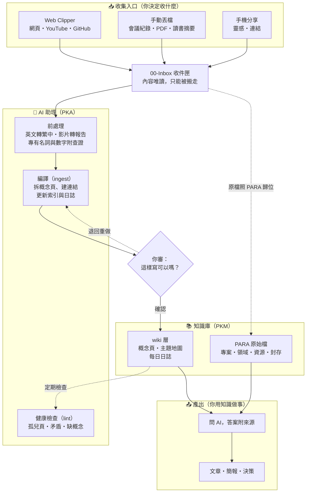
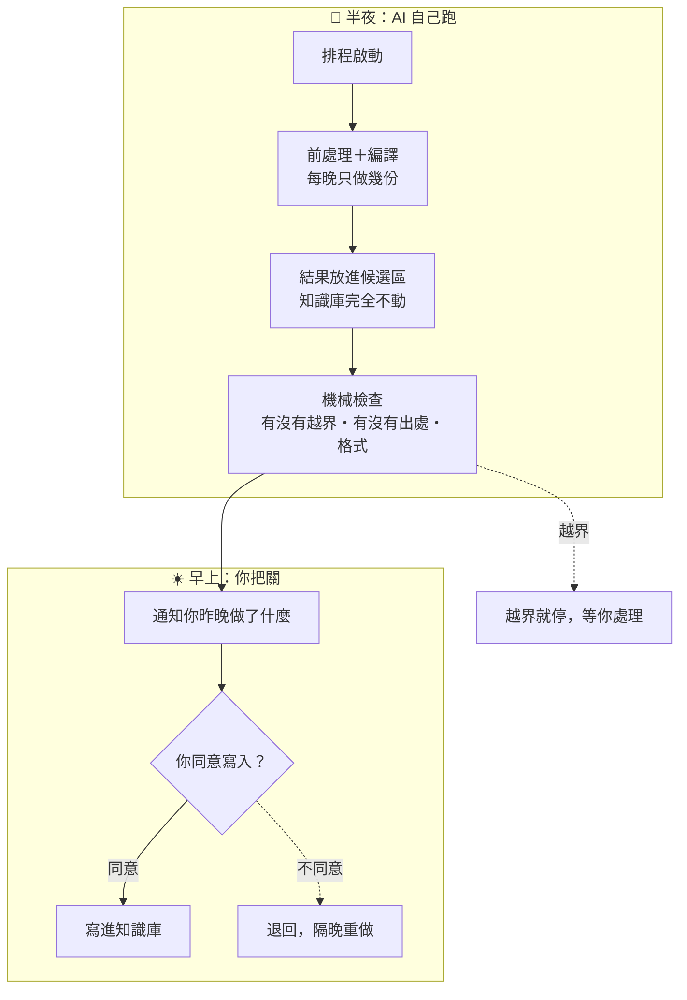

# 02 PKM 與 PKA 架構：知識怎麼流、AI 助理怎麼分工、人在哪裡把關

> 📌 **這篇管**：知識的路線（PKM 層）、AI 助理的分工（PKA 層）、人把關的位置、讓知識庫不亂的機制｜**不管**：方法論來源（看 [[01 方法論總覽]]）、怎麼開始用（看 [[03 Vault建置與上手]]）

## 先分清楚兩層

| 層 | 是什麼 | 在這個 vault 裡 |
|---|---|---|
| **PKM**（個人知識管理） | 知識**放在哪、怎麼分類、怎麼連起來** | 收件匣、wiki 知識層、PARA 原始檔、附件 |
| **PKA**（個人知識助理） | **誰在處理**這些知識 | 一開始是一個 AI 助理（例如 Claude Code）照 `CLAUDE.md` 工作；需要時再加 |

PKM 是倉庫和貨架，PKA 是倉庫裡的工作人員。**你是店長**：決定進什麼貨、檢查上架對不對、決定拿什麼出去用。

## 架構總圖

## PKM 層：各區放什麼

| 區域 | 放什麼 | 規矩 |
|---|---|---|
| **00-Inbox 收件匣** | 剛收進來、還沒處理的東西 | 內容唯讀、不改檔名；處理完就搬走 |
| **wiki 知識層** | AI 編譯出來的概念頁（依領域、類型分資料夾）、主題地圖、每日日誌 | 由 AI 維護；每頁標狀態：草稿、已審（stable）、過時；草稿升級一定要你批准 |
| **PARA 原始檔** | 專案、領域、資源、封存四個櫃子，放原始文件 | **原始檔不刪、不改、不改名**；完成的往封存搬，封存是「目前用不到、但要查得到」 |
| **附件** | 圖片、PDF | 網路圖片一律下載到本機，不靠外部連結 |

**兩層的關係**：PARA 放「原文」，wiki 放「AI 從原文萃取出的概念」，每個概念頁都標出它來自哪份原文。這就是 [[01 方法論總覽]] 說的「第二大腦管流程和分類、卡片盒管原子化和連結」疊在一起用。

## PKA 層：從一個助理開始

**第一個月只要一個 AI 助理**，照 `CLAUDE.md` 做三件事：整理收件匣、回答問題、定期健康檢查。

等你發現某件事每次都在重複、而且你已經知道怎麼判斷對錯，再把它分出去。常見的分工長這樣（**範例，不是必備**）：

| 角色 | 做什麼 | 能寫哪裡 |
|---|---|---|
| **整理員** | 把收件匣編譯成概念頁 | wiki 層（每次先給你看） |
| **查詢員** | 根據知識庫回答問題，附出處 | 不寫任何檔，只讀 |
| **歸檔員** | 把你丟的連結整理成筆記、做剪報前處理 | 只能在收件匣新建檔 |
| **複核員** | 檢查別的助理寫得對不對 | 只寫複核意見 |
| **排程員** | 半夜自動跑整理，早上給你看結果 | 只寫 vault 外的候選區，你同意才寫進去 |

**分工的三個原則**：
- **產出方不驗收自己**：A 寫的交給 B 檢查，不讓 A 自己說「我做好了」
- **能寫的範圍寫在設定裡**，不靠「請它不要亂寫」：例如查詢員根本沒有寫檔的權限
- **機密走本機、公開才上雲**：公司資料、個人財務不送雲端模型；需要時用本機模型

## 進階：讓 AI 夜間自己跑

助理分工穩定之後，可以讓整理在半夜自動跑。關鍵是**中間隔一個候選區**，AI 不直接寫進知識庫：

**放手的節奏（畢業制）**：一開始每批都全檢；連續幾批都乾淨才改成抽檢；抽檢一段時間錯誤率夠低、沒有越界，才改成只看例外；**只要越界一次就退回全檢**。放手可以收回，所以敢放。

## 人在哪裡把關

| 環節 | 誰決定 | 為什麼留給人 |
|---|---|---|
| 收什麼 | 你按 Web Clipper、你丟檔 | 收集的品質決定一切；AI 不會知道什麼對你有共鳴 |
| 要不要寫進知識庫 | 每次先看 AI 的提案 | 寫進知識庫就會被引用，錯了會擴散 |
| 草稿升級成「已審」 | 你批准 | 「已審」代表你相信它，AI 引用時就不再加警告 |
| 方向與取捨 | 你定目標、範圍、明確不做什麼 | 技術細節可以交給 AI，**方向是人的** |
| 不可逆的一步 | 你親自確認 | 刪除、對外發佈、動正式資料，不能只聽 AI 說「好了」 |
| 規則要不要改 | 你同意 | 規則管所有助理，改錯了大家一起錯 |

這套分級有個名字：**人在迴圈內**（每個決定都點頭）→ **人在迴圈上**（AI 自己跑，紅燈亮才介入）→ **人在迴圈之上**（你只定目標和界線）。風險越高、越不可逆，人就站得越近。

## 讓知識庫不亂的機制

人不可能盯每一個檔，所以把檢查交給機器，人只看紅燈：

| 機制 | 做什麼 | 在這個 vault 裡 |
|---|---|---|
| 寫檔前先提案 | AI 改任何東西前先給你看 | `CLAUDE.md` 規則 E |
| 健康檢查分數 | 找孤兒頁、壞連結、缺的概念，給 0～100 分 | `wiki/tools/lint.py`、說「巡一下 wiki」 |
| 每日日誌 | 每天做了什麼、依據是什麼 | `wiki/daily/` |
| 連動清單 | 改了 A 要同步改哪些 B | `Wiki操作文件/Wiki_維護觸發規則.md` |
| 狀態面板 | 開工先看現況與待辦 | `wiki/PROGRESS.md` |

> ⚠️ 檢查工具自己也會誤報。誤報太多，人就會習慣忽略紅燈，那比少一道檢查更糟——所以誤報要從源頭修掉。

## 跟 Tom 的 PKA 示範比一比

| | Tom 的示範 | 這個 vault |
|---|---|---|
| 資料 | 一個本機資料夾＋SQLite 資料庫 | 一個 Obsidian vault（純文字 Markdown） |
| 介面 | 終端機＋自製 HTML 檢視頁 | Obsidian（電腦、手機） |
| 助理 | 1 個總管＋3 個專才 | 先 1 個，需要時照上面的範例分工 |
| 記憶 | 每個資料夾一份 CLAUDE.md | 一份 `CLAUDE.md` 規範本體＋拆出的規則檔 |
| 把關 | 待審成果放「owners inbox」 | 寫檔前先提案＋草稿要人批准才升級 |

共同點：**資料留在自己手上，AI 是可以換的工作人員**。

---

← 回到 [[40-Resources/PKM入門/README|PKM 入門]]｜上一篇：[[01 方法論總覽]]｜下一篇：[[03 Vault建置與上手]]
