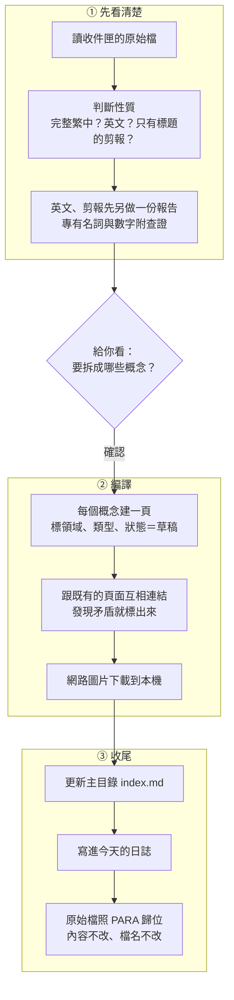

# 03 Vault 建置與上手：外掛、一次整理、第一週、常見的坑

> 📌 **這篇管**：這個 starter 已經做好什麼、還要自己裝什麼、AI 一次整理做了什麼、第一週怎麼練、常見的坑｜**不管**：方法論（看 [[01 方法論總覽]]）、AI 助理分工（看 [[02 PKM與PKA架構]]）

## 一句話

**好用的 vault 不是一次設計好的，是一邊用一邊長出來的。** 這個 starter 給你的是骨架和一套別人踩過坑之後留下的規則；你的第一週只要學會「丟進收件匣 → 請 AI 整理 → 看它的提案」這個循環。

## 這個 starter 已經做好的

| 項目 | 在哪裡 | 做什麼 |
|---|---|---|
| PARA 資料夾＋收件匣 | `00-Inbox/`～`50-Archive/` | 每個資料夾都有 README，說明放什麼 |
| 給 AI 的說明書 | `CLAUDE.md` | 結構、哪些不能改、整理流程、改之前要先問你 |
| Claude 技能 7 個 | `.claude/skills/`（Claude Code 自動載入）、`plugin/`（Cowork 安裝檔） | 收進來（ingest）、健康檢查（lint）、查詢（query）、修補（repair）、長文編譯、審草稿、YouTube 轉報告 |
| 拆出的規則 | `wiki/rules/` | 每條規則的細節與理由，AI 需要時才讀 |
| 連動清單 | `Wiki操作文件/Wiki_維護觸發規則.md` | 改了 A 要同步改哪些 B |
| 健康檢查工具 | `wiki/tools/lint.py` | 找孤兒頁、壞連結、缺的概念，算分數 |
| 範本 | `Templates/` | 概念頁、長文、個人日記、wiki 日誌 |
| 內建外掛 | `.obsidian/plugins/` | Dataview、Templater、Omnisearch、Excalidraw |
| 寬版面 | `.obsidian/snippets/wide-pages.css` | 表格多的頁面不會被擠成一條 |
| Web Clipper 範本說明 | `Wiki操作文件/Wiki_Web_Clipper_範本.md` | 瀏覽器剪報怎麼存進收件匣 |

## 外掛：還可以裝什麼

| 外掛 | 用來做什麼 | 新手需要嗎 |
|---|---|---|
| **Dataview** | 用查詢自動產生清單與儀表板（最近更新、草稿待審、孤兒頁） | ✅ 已內建 |
| **Templater** | 範本（每日筆記、會議紀錄） | ✅ 已內建 |
| **Omnisearch** | 全文搜尋（含 PDF） | ✅ 已內建 |
| **Excalidraw** | 手繪白板 | ✅ 已內建 |
| Tasks | 待辦清單跨頁彙整 | 有在記待辦再裝 |
| Calendar | 側欄行事曆、點日期開每日筆記 | 選用 |
| QuickAdd | 一鍵新增筆記到指定位置 | 選用 |
| PDF++ | PDF 畫重點、引用 | 讀很多 PDF 再裝 |

- **手機**：裝 Dataview 就夠，手機主要是看和快速記，裝太多會慢
- **收集**：瀏覽器裝 **Obsidian Web Clipper**，範本設定存到 `00-Inbox/`

## 一次整理（ingest）做了什麼

這是整個 vault 最核心的動作。你說 `ingest 00-Inbox/某篇.md`，AI 會：



**每個概念頁的開頭**都有一段固定欄位，AI 和 Dataview 都靠它分類與過濾：

```yaml
---
title: "累進式摘要"
domain: learning          # 領域：一個主題只開一個，不開同義詞
type: pattern             # 類型：固定 8 種（流程、概念、角色、文件、技巧、系統、規則、人物）
status: draft             # 草稿 → 已審（你批准）→ 過時
source:
  - "[[原始檔名]]"        # 來自哪份原文
created: 2026-01-01
updated: 2026-01-01
---
```

> 為什麼類型只准 8 種：類型是給機器過濾用的。一旦「不好歸類就開新類型」，它就變成第二套標籤，查詢和檢查同時失效。

## 第一週怎麼練

| 天 | 做什麼 |
|---|---|
| 1 | 照 README 的 5 分鐘 Setup 打開 vault、在根目錄開 Claude Code；讀完這三篇入門 |
| 2 | 用 Web Clipper 收 5 篇你**真的有共鳴**的文章到 `00-Inbox/` |
| 3 | 請 AI 整理其中一篇：`ingest 00-Inbox/某篇.md`。**先看它的提案**，覺得拆得不對就直接說 |
| 4 | 再整理兩篇，打開 Obsidian 的關係圖，看新概念頁連到哪些舊頁面 |
| 5 | 問 AI 一個問題，要它「只根據 wiki 回答、附上來源」 |
| 6 | 說「巡一下 wiki」，看健康檢查報告 |
| 7 | 回頭看這週：哪些事你願意以後不用再看提案？把它記下來，那是你第一個可以放手的地方 |

## 規則怎麼長大

- **先遇到問題，才加規則**。`CLAUDE.md` 裡的規則每一條都是某次出錯後留下的；你還沒遇到的情境，那條規則對你就只是噪音
- 用不到的規則可以刪，但刪之前先看 `wiki/rules/` 裡那條的「為什麼」
- 你自己的規則（例如「這類文章不要拆」）直接告訴 AI，請它寫進 `CLAUDE.md`——**規則只放一份**，不要在別處抄一份
- 改了 `CLAUDE.md` 就在版本歷程記一筆，之後才知道是哪次改動造成的

## 常見的坑

| 坑 | 發生什麼 | 怎麼避免 |
|---|---|---|
| vault 放在 iCloud／OneDrive／Dropbox 又用 git | 雲端同步會弄壞 `.git/` 裡的檔案，冒出大量衝突副本 | git 版本控制放在不同步的本機路徑；跨機用 git push 到你自己的私人 repo |
| 檢查工具只掃第一層資料夾 | 子資料夾裡的頁面全被漏掉，分數是假的 | 掃資料夾的工具一定要往下掃到底（`lint.py` 已經是） |
| Windows 預設不是 UTF-8 | 腳本在 Mac 正常、到 Windows 中文全亂碼 | 讀寫檔一律指定 UTF-8；在 A 平台驗過不等於 B 平台也行 |
| Obsidian 搬檔會改寫連結 | 連結被改成長長的相對路徑，之後重組就斷 | 連結只寫檔名 `[[檔名]]`；搬完檢查反向連結有沒有少 |
| 會刪東西的同步指令 | 把不該刪的設定資料夾也刪了 | 任何會刪東西的指令，都配一份逐條看過的排除清單 |
| 以為垃圾桶能救回 | 雲端同步的 vault 垃圾桶會被清 | 垃圾桶不是備份 |
| 圖表文字以 `1.` 開頭 | 被當成編號清單，整張圖畫不出來 | 圖表文字含特殊符號一律加引號 |
| 規則寫了，AI 照樣漏 | 靠 AI「記得」的規則遲早會漏 | 重要的規則做成檢查工具，或寫進連動清單 |
| 什麼都收 | 收件匣堆成垃圾場，AI 整理不完 | 只收真的有共鳴的；收件匣定期清空 |

## 讀完想一想

1. 你的筆記要放雲端軟體，還是放自己電腦的純文字檔？各換到什麼、失去什麼？
2. 哪幾件事你絕對不讓 AI 自己決定？把它寫進你的 `CLAUDE.md`。
3. 「常見的坑」那張表，哪一個你覺得你也會踩？

---

← 回到 [[40-Resources/PKM入門/README|PKM 入門]]｜上一篇：[[02 PKM與PKA架構]]
