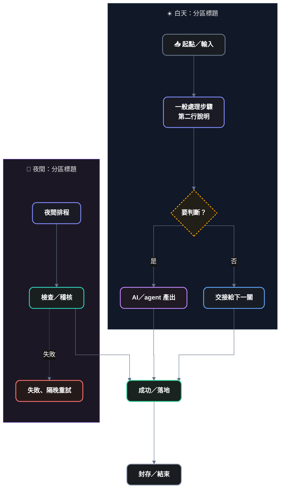

# Mermaid 圖範本（Obsidian Dark — Grouped Workflow）

> 規範本體：[[rule-W-mermaid-visual-style|規則 W]]。本檔只放可直接複製的程式碼，不重複理由。
> 用法：① 每張圖第一行貼「共用開頭」（**流程圖有分區時，最後一行換成 ①-2**）→ ② 流程圖再貼「九類語意色」並替**每個節點**掛 class → ③ xychart 改用最下面那段開頭 → ⑤ 要匯出成圖片檔就用 Pele。
> 🔀 連線一律 `"curve": "stepAfter"`，直向橫向都一樣，不要改成 `step`。預覽時接在方塊左右兩側的線若箭頭貼著邊、沒指進方塊，在圖的最後加 `linkStyle <編號> interpolate stepBefore`（編號＝連線在原文裡的順序，從 0 數；[[rule-W-mermaid-visual-style#W.2 怎麼用|規則 W §W.2]] 第 3 步）。
> ⚠️ 開頭的 `"themeCSS": "filter: none !important;"` 不要刪：Obsidian 深色模式會把 Mermaid 圖整張反相，這行讓圖自己取消，所有圖種、每台裝置都有效（[[rule-W-mermaid-visual-style#W.6 已知限制|規則 W §W.6]]）。

## ① 共用開頭（所有圖種都貼）

```text
%%{init: {
  "theme": "base",
  "themeCSS": "filter: none !important;",
  "themeVariables": {
    "background": "#181818", "fontSize": "15px",
    "primaryColor": "#191C20", "primaryTextColor": "#FFFFFF", "primaryBorderColor": "#64748B",
    "lineColor": "#64748B", "textColor": "#E8E8E8", "titleColor": "#E8E8E8",
    "clusterBkg": "#111827", "clusterBorder": "#334155", "edgeLabelBackground": "#131313",
    "noteBkgColor": "#221F18", "noteBorderColor": "#F59E0B", "noteTextColor": "#FFFFFF",
    "attributeBackgroundColorOdd": "#1B1F23", "attributeBackgroundColorEven": "#191C20",
    "rowOdd": "#1B1F23", "rowEven": "#191C20",
    "cScale0": "#1B1B26", "cScale1": "#1F1A23", "cScale2": "#191F1F",
    "cScale3": "#19231F", "cScale4": "#181D25", "cScale5": "#221F18",
    "cScale6": "#1B1B26", "cScale7": "#1F1A23", "cScale8": "#191F1F",
    "cScale9": "#19231F", "cScale10": "#181D25", "cScale11": "#221F18"
  },
  "flowchart": {"curve": "stepAfter", "nodeSpacing": 40, "rankSpacing": 50, "padding": 14, "wrappingWidth": 320}
}}%%
```

## ①-2 有分區（subgraph）的流程圖：開頭最後一行換成這行

> 讓分區標題離方框上緣 14、上下區塊之間約 70～76。沒有分區的圖照 ① 不改。理由與實測見 [[rule-W-mermaid-visual-style#W.4 流程圖寫法|規則 W §W.4]]、§W.6。

直向（`flowchart TD`／`TB`）：

```text
  "flowchart": {"curve": "stepAfter", "nodeSpacing": 40, "rankSpacing": 100, "padding": 14, "wrappingWidth": 320, "subGraphTitleMargin": {"top": 14, "bottom": 10}}
```

橫向（`flowchart LR`）：

```text
  "flowchart": {"curve": "stepAfter", "nodeSpacing": 70, "rankSpacing": 50, "padding": 14, "wrappingWidth": 320, "subGraphTitleMargin": {"top": 14, "bottom": 10}}
```

> 直向圖改完寬度多 15% 以上（多半是分區內用 `direction LR`）：把 `rankSpacing` 從 100 降到 70。改完重新預覽，檢查 `linkStyle` 的編號還對不對。

## ② 九類語意色（流程圖貼在圖的最後）

```text
    classDef input   fill:#191C20,stroke:#64748B,stroke-width:2px,color:#FFFFFF,font-weight:bold,rx:10px,ry:10px
    classDef step    fill:#1B1B26,stroke:#818CF8,stroke-width:2px,color:#FFFFFF,font-weight:bold,rx:10px,ry:10px
    classDef agent   fill:#1F1A23,stroke:#C084FC,stroke-width:2px,color:#FFFFFF,font-weight:bold,rx:10px,ry:10px
    classDef handoff fill:#181D25,stroke:#60A5FA,stroke-width:2px,color:#FFFFFF,font-weight:bold,rx:10px,ry:10px
    classDef decide  fill:#221F18,stroke:#F59E0B,stroke-width:2px,stroke-dasharray:4 3,color:#FFFFFF,font-weight:bold
    classDef check   fill:#191F1F,stroke:#2DD4BF,stroke-width:2px,color:#FFFFFF,font-weight:bold,rx:10px,ry:10px
    classDef ok      fill:#19231F,stroke:#34D399,stroke-width:2px,color:#FFFFFF,font-weight:bold,rx:10px,ry:10px
    classDef fail    fill:#241A19,stroke:#F87171,stroke-width:2px,color:#FFFFFF,font-weight:bold,rx:10px,ry:10px
    classDef archive fill:#191C20,stroke:#94A3B8,stroke-width:2px,color:#FFFFFF,font-weight:bold,rx:10px,ry:10px
```

每個 class 用在哪裡：[[rule-W-mermaid-visual-style#W.3 九類語意色|規則 W §W.3]]。

面板（`subgraph`）：一般區塊不用另外設色（共用開頭已給深藍 `#111827`）；夜間或要跟其他區分開的區塊加一行 `style <ID> fill:#1C1725,stroke:#4C1D95,color:#E8E8E8`（深紫）。

## ③ 流程圖完整範例（複製後改文字）



## ④ xychart 開頭（取代共用開頭）

> xychart 只要寫了 `xyChart` 這一段，沒寫到的背景、文字、軸線就會變回白底黑字，所以要整段一起貼。

```text
%%{init: {
  "theme": "base",
  "themeCSS": "filter: none !important;",
  "themeVariables": {
    "background": "#181818", "fontSize": "15px", "textColor": "#E8E8E8",
    "xyChart": {
      "backgroundColor": "#181818", "titleColor": "#E8E8E8",
      "xAxisLabelColor": "#E8E8E8", "xAxisTitleColor": "#E8E8E8", "xAxisTickColor": "#64748B", "xAxisLineColor": "#64748B",
      "yAxisLabelColor": "#E8E8E8", "yAxisTitleColor": "#E8E8E8", "yAxisTickColor": "#64748B", "yAxisLineColor": "#64748B",
      "plotColorPalette": "#818CF8, #2DD4BF, #C084FC, #34D399, #F59E0B, #60A5FA"
    }
  }
}}%%
```

## ⑤ 用 Pele 畫成檔案（匯出、HTML 報告、給外部看的圖）

> 規範：[[rule-W-mermaid-visual-style#W.8 用 Pele 畫匯出與展示的成品|規則 W §W.8]]。原文照 ①～④ 寫，不用另寫一份；Obsidian 筆記裡的區塊照舊由 Obsidian 畫。

```text
node wiki/tools/pele/render.mjs <筆記.md 或 .mmd> <輸出.svg> [--png 輸出.png] [--html 輸出.html] [--index N]
```

- 配色只有一份：`wiki/tools/pele/rule-w-pele.css`（render.mjs 自動嵌進 SVG；要給別的網頁用就貼這個檔）
- 這台還沒裝（需要 Node.js）：macOS／Linux `sh wiki/tools/pele/install.sh`；Windows `powershell -ExecutionPolicy Bypass -File wiki\tools\pele\install.ps1`
- 出 PNG 要本機有 Chrome 或 Edge；畫好一定要打開看一次
