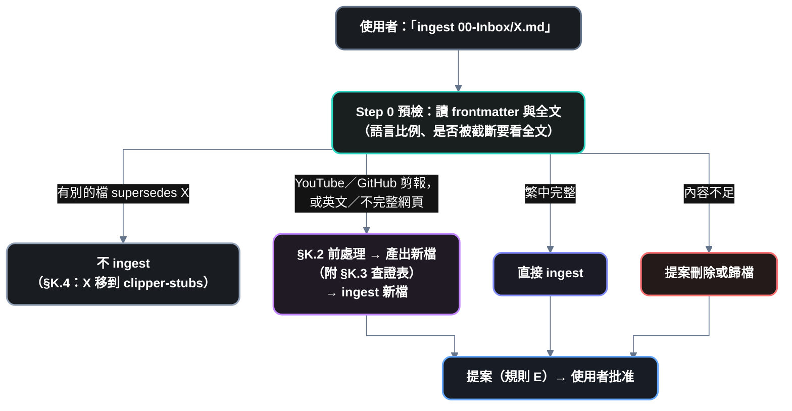

# 規則 K：raw 預檢、剪報前處理與查證

**核心原則**：wiki-ingest（或 LLM 收到「ingest XXX」指令）**步驟 0 必須先偵測 raw 性質**，依類型路由到對應前處理，不要假設 raw「已經是可 ingest 狀態」。

> ⚡ **快路徑**：raw 是用 [[Wiki_Web_Clipper_範本|Obsidian Web Clipper]] 抓進來的話，frontmatter 已自帶 `pending_action` 線索 → 直接讀該欄位即知該做什麼。
> 🔴 **v2 起**：只有標題的剪報、GitHub 剪報、英文或被截斷的網頁，**先另做一份附查證表的報告，再 ingest 那份報告**（§K.2–K.4）。不論哪個 AI、手動或排程，一律照這條。

## §K.1 Step 0 預檢分流表

預檢要讀 frontmatter 和**全文**——語言比例、有沒有被截斷，只看前幾行判斷不出來。

| Raw 內容 | 偵測規則 | 處理 |
|---------|---------|---------|
| **frontmatter `pending_action: youtube-skill`** | Web Clipper YouTube 範本（只有標題與描述的空殼） | **§K.2 前處理**：補成完整影片報告（單支走本機 fast-path，[[heuristic-4-yt-fastpath\|經驗法則 4]]；多支才走 youtube-to-notebooklm）——原剪報本身不 ingest |
| **frontmatter `pending_action: github-skill`** | Web Clipper GitHub 範本 | **§K.2 前處理**：GitHub API 實查後寫評估——原剪報本身不 ingest |
| **frontmatter `pending_action: rule-K-precheck`** | Web Clipper Default 範本 | 英文或內容不完整 → **§K.2 前處理**產繁中報告；繁中且完整 → 照下方各列 |
| **frontmatter `supersedes:` 指到本檔的另一份檔存在** | 已被前處理產出取代 | **不 ingest**；原剪報照 §K.4 歸檔 |
| **frontmatter `atomize: false`** 或 **路徑含 `longform/`** | longform | 建 1 個 entity（不拆），詳見 [[CLAUDE]] §3.1.1 |
| **裸 YT URL** | 檔長 < 300 bytes + match URL | 視同 YouTube 空殼，走 §K.2 |
| **裸非 YT URL** | 檔長 < 300 bytes + non-YT URL | 視同不完整網頁，走 §K.2 |
| **大量英文文章** | 檔長 > 5 KB + 英文字元比例 ≥ 0.3 | 視同英文網頁，走 §K.2（產繁中報告＋查證表） |
| **簡中文章** | 含「数据 / 软件 / 这个」 | ingest 時順手簡轉繁 + 詞彙台灣化 |
| **繁中 + 結構完整** | 預設 | **直接 ingest**（標準流程） |
| **空檔 / 只有 frontmatter** | body < 50 bytes | 「raw 內容不足，無法 ingest。要刪嗎？」 |

## §K.2 剪報前處理

| 剪報 | 前處理 | 產出（新建在 `00-Inbox/`） | 格式 |
|---|---|---|---|
| YouTube 空殼 | 單支：yt-dlp 抓字幕，沒有字幕才抓音檔＋本機轉錄（[[heuristic-4-yt-fastpath\|經驗法則 4]]）；多支跨來源：youtube-to-notebooklm | `<空殼檔名>_報告.md` | youtube-to-notebooklm 技能的報告格式＋§K.3 查證表 |
| GitHub | GitHub API 實查（`gh api repos/<owner>/<repo>`：stars、license、最後更新）＋讀 README | `<owner>-<repo>_評估.md` | 用途一段話＋實查數據表＋適不適合你＋§K.3 查證表（第一列固定是 repo 全名） |
| 英文或不完整網頁 | 重新抓原網頁全文 | `<原剪報檔名>_報告.md` | 繁中摘要＋重點＋§K.3 查證表 |

- **產出另存新檔**：frontmatter 加 `supersedes: "[[<原剪報檔名>]]"`，不寫 `pending_action`；同名檔已存在就停下來回報
- **已經收過的不重做**：網址已出現在 `40-Resources/` 或既有 entity 的 `source` → 不前處理，原剪報直接列入待歸檔
- **失敗不產檔**：抓不到、轉錄失敗 → 不建任何檔，直接回報原因
- **落檔前自己對一次格式**：查證表表頭逐字、分隔列、結果只用三種寫法、`正確`／`更正` 有出處、`查無` 寫了查過哪裡（§K.3）。⚠️ 對格式只證明**形狀**，證明不了出處真的查過——真假靠你抽查

## §K.3 查證表

每份前處理產出都附這張表，表頭逐字照抄：

```markdown
| 項目 | 素材原文 | 查證結果 | 出處 |
|---|---|---|---|
| 頻道 | 某某頻道 | 正確 | yt-dlp metadata |
| 產品名 | Nuos | 更正為「Nous Research」 | https://nousresearch.com |
| 數字 | 540 萬次下載 | 查無 | 查過：官方網站、下載頁 |
```

| 欄 | 規定 |
|---|---|
| 項目 | 專有名詞、人名、產品名、公司名、版本號、數字、日期、頻道 |
| 素材原文 | 照抄素材，不先改 |
| 查證結果 | **只能三種**：`正確`、`更正為「…」`、`查無` |
| 出處 | `正確`、`更正` 要附網址，或第一手資料標記（`yt-dlp metadata`、`gh api`）；`查無` 寫成「查過：<查了哪裡>」，冒號後面不能空 |

- **查什麼**：素材與產出裡**所有**專有名詞、人名、產品名、公司名、版本號、數字、日期；語音轉錄稿全查（[[heuristic-7-transcript-verification|經驗法則 7]]）。查不到不要自己換成「應該是」的名字——那就是 `查無`
- **權威來源順序**：① 第一手資料（yt-dlp、GitHub API）② 官方網站、官方文件、論文 ③ 原網頁本身 ④ 可信第三方。🔴 **不得拿另一份 AI 摘要或 AI 轉錄當出處**
- **怎麼用**：報告正文裡 `更正` 直接用更正後的寫法；`查無` 保留原文，第一次出現時寫成「<原文>（查無）」。GitHub 評估更嚴：`查無` 的名稱只能出現在查證表
- 🔴 **進 wiki 時**：entity 正文只用 `正確` 或 `更正` 後的名稱；**`查無` 的不寫進正文，只留在「待解」並標查無**

## §K.4 原剪報去處

- 原剪報**內容不改、不刪、不改名**（規則 A）
- **YouTube 與網頁：報告做好就歸檔**——`_報告` 寫進 `00-Inbox/`、通過 §K.2 的格式自查後，被它 `supersedes:` 的原剪報移到 `50-Archive/raw-archive-clipper-stubs/YYYY-MM/`，**00-Inbox 只留報告一份**
  - 為什麼：不移的話同一支影片在收件匣並排兩份（`X.md` 與 `X_報告.md`），看起來像重複；原剪報要留的是證據（剪了什麼、什麼時候剪），不必留在眼前
  - 不移：報告沒過自查、或封存處已有同名檔 ⇒ 原剪報留在收件匣，列給使用者看
  - 報告被退件要重做 ⇒ 從 clipper-stubs 拿回 `00-Inbox/` 再前處理；`supersedes:` 用檔名連結，搬到封存照樣連得到
- 已收過（網址已在 `40-Resources/` 或既有 entity 的 `source`）的原剪報沒有報告可指，在使用者批准那一批時一起移到 `50-Archive/raw-archive-clipper-stubs/YYYY-MM/`
- **GitHub：等落地才歸檔**——依評估內容新建 `40-Resources/GitHub/<owner>-<repo>.md`，評估檔與原剪報一起移 `50-Archive/raw-archive-github-clips/`。預設不抽 wiki entity；想抽就跟 AI 說

## 決策樹



## 例外

- 使用者明確說「就是要從這檔直接抽 entity 不要前處理」→ skip 預檢（**查證不豁免**：專有名詞仍照 §K.3）
- raw 是混合型（前半繁中筆記 + 後半英文引用）→ 預設走標準 ingest
- 使用者已批准的 chain skill 流程內部步驟，不必每步再 step 0 預檢

## 0. 版本歷程

| 版本 | 日期 | 主要變動 |
|------|------|---------|
| v2.0 | 2026-11-17 | **剪報前處理與查證**：新增 §K.2 剪報前處理（YouTube 空殼、GitHub、英文或不完整網頁先另做一份報告，`supersedes:` 指回原剪報）、§K.3 查證表（表頭逐字、結果只能三種、查無的名稱不進 entity 正文）、§K.4 原剪報去處（報告做好就移 clipper-stubs，收件匣只留一份）；分流表補 `github-skill` 與「被 supersedes 取代」兩列、YouTube 改單支 fast-path；預檢改讀全文；決策樹改 Mermaid。同步自 Vincent5588 規則 K v1.1–v2.1.1 的通用部分（維護者自用的排程代理、檢查腳本與前處理技能不搬，改成「落檔前自己對一次格式」） |
| v1.0 | 2026-05-12 | 從 CLAUDE.md §10 拆出，同步自 Vincent5588 v1.3.36 |
