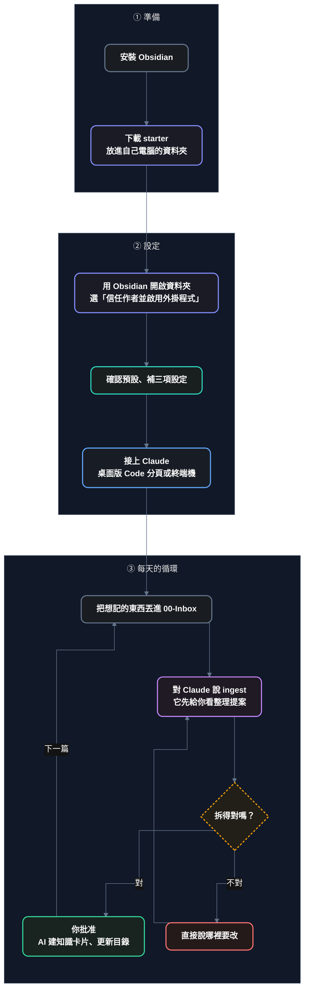

# 📖 新手使用手冊

> 給**從沒用過 Obsidian、也沒用過 Claude Code** 的人。照順序做，大約 40 分鐘可以完成安裝並整理好第一篇筆記。
> 對應版本：starter v1.13、Claude 外掛 karpathy-wiki-pattern v1.4.7 公開版、Obsidian 1.15（繁體中文介面）。
> 進階用法與詳細教學：[vincent5588.com](https://vincent5588.com/articles)（§15 有分主題的文章清單）。

## 先看這張圖：整個流程只有三段

準備和設定都只做一次，各約 15 分鐘；之後就是每天重複的循環。



---

## 0. 先搞懂三件事（2 分鐘）

| 名詞 | 白話 |
|---|---|
| **Obsidian** | 一個免費的筆記軟體。筆記就是你電腦裡的 `.md` 純文字檔，不綁雲端、不怕軟體倒閉 |
| **儲存庫（vault）** | 就是「一個資料夾」。Obsidian 打開哪個資料夾，那個資料夾就是你的知識庫 |
| **Claude Code** | Anthropic 出的 AI 助理，可以直接讀寫你資料夾裡的檔案。這個 starter 已經幫它寫好說明書（`CLAUDE.md`）和 7 個整理技能 |

**分工只有一句話：你負責「收集」和「判斷」，AI 負責「閱讀、拆概念、建連結、歸檔」。** AI 每次要寫檔之前都會先給你看提案，你說好它才動。

---

## 1. 準備清單

| 項目 | 必要？ | 說明 |
|---|---|---|
| Obsidian | ✅ 必要 | 免費，[obsidian.md/download](https://obsidian.md/download) |
| Claude 付費方案 | ✅ 必要 | Pro 以上的訂閱方案（Pro、Max、Team、Enterprise 等），或 API（Console）帳號；**免費方案不能用 Claude Code**。API 帳號只能用終端機版 |
| Claude 桌面版 **或** 終端機版 Claude Code | ✅ 二選一 | 新手建議桌面版，不用打指令（見 §6） |
| Git for Windows | 🟡 Windows 建議 | 終端機版 Claude Code 在 Windows 建議裝；用桌面版可略 |
| Obsidian Web Clipper | 🟡 建議 | 瀏覽器擴充功能，一鍵把網頁存進收件匣（見 §5.6） |
| Ollama | ⚪ 選用 | 只有要讓 AI 看圖、幫圖片加搜尋關鍵字才需要（見 §5.2 AI Image Analyzer） |
| Python 3 | ⚪ 選用 | 健康檢查工具 `wiki/tools/lint.py` 用；沒裝 AI 也能用別的方式檢查 |
| Node.js | ⚪ 選用 | 只有要把 Mermaid 圖匯出成圖片檔才需要（見 §10） |

---

## 2. 步驟一：安裝 Obsidian

1. 到 [obsidian.md/download](https://obsidian.md/download) 下載你的系統版本（Windows／Mac／iPhone／Android 都有），照預設一路安裝。
2. 第一次開啟如果是英文：左下角齒輪 ⚙️（或按 `Ctrl + ,`／Mac `Cmd + ,`）→ **General** → **Language** → 選 **繁體中文** → 依提示重新啟動。

> 之後本手冊寫的選單名稱都是**繁體中文介面**的名稱。第一次用 Obsidian，可以先看 [Obsidian 新手入門](https://vincent5588.com/articles/obsidian-beginner)（介面、快捷鍵、Markdown、雙向連結，約 30 分鐘）。

---

## 3. 步驟二：取得 starter，放進自己電腦

### 方法 A：下載 ZIP（新手用這個）

1. 打開 [github.com/Vincent5588/karpathy-wiki-starter](https://github.com/Vincent5588/karpathy-wiki-starter)
2. 按綠色 **Code** 按鈕 → **Download ZIP**
3. 解壓縮，把資料夾改成你喜歡的名字，例如 `my-wiki`
4. 搬到你要長期放的位置，例如 Windows `D:\Notes\my-wiki`、Mac「文件」資料夾裡

> ⚠️ **整個資料夾一起搬**。裡面有兩個隱藏資料夾 `.obsidian`（外掛與設定）和 `.claude`（AI 技能），只複製看得到的檔案會漏掉它們，外掛和技能就全部不見。

### 方法 B：用 git（會用 git 的人）

```bash
git clone https://github.com/Vincent5588/karpathy-wiki-starter.git my-wiki
```

```bash
cd my-wiki
```

```bash
git remote remove origin
```

最後一行是把它跟原作者的 repo 斷開，之後你的改動不會推回去。

### 放在哪裡最安全

| 情況 | 建議 |
|---|---|
| 第一次用 | 放**自己電腦的一般資料夾**，最單純 |
| 想在多台電腦／手機看 | 可以放 iCloud／OneDrive，但：① **不要在雲端資料夾裡用 git**（雲端同步會弄壞 `.git`，詳見 [[rule-N-cloud-git-discipline\|規則 N]]）② 雲端偶爾會把剛被改過的檔案改名成「檔名 2.md」，看到就比對內容後改回原名（AI 寫雲端資料夾的方法見 `CLAUDE.md` §13 鐵則 4） |
| 想備份與版本紀錄 | 用 git 推到你**自己的私人** repo，git 資料夾放在雲端同步範圍之外 |

---

## 4. 步驟三：用 Obsidian 打開，確認預設、補三項設定

### 4.1 打開儲存庫

1. 開 Obsidian → 選 **開啟資料夾為儲存庫** → 選你的 `my-wiki` 資料夾
   （已經開著別的儲存庫的話：點左下角儲存庫名稱 → **管理儲存庫...**，就會回到這個畫面）
2. 跳出安全提示時選 **信任作者並啟用外掛程式**

> 為什麼要信任：starter 已經內建 8 個外掛（§5）。選「在受限模式下瀏覽儲存庫」的話，外掛全部不會執行，目錄頁的表格會變成一堆程式碼。

打開後左側應該看到 `00-Inbox`～`50-Archive`、`wiki`、`Attachments` 等資料夾，佈景主題是內建的 **Things**。筆記範本放在 `40-Resources/Templates/`。

### 4.2 已經預設好的（打開確認即可）

打開設定：左下角齒輪 ⚙️，或 `Ctrl + ,`（Mac `Cmd + ,`）。

| 設定 | 在哪裡看 | 預設值 | 作用 |
|---|---|---|---|
| 連結只寫檔名 | **檔案與連結** → **內部連結格式** | 以儘可能簡短的形式插入；**使用 `[[Wikilinks]]`** 開；**始終更新內部連結** 開 | 連結長得像 `[[概念名稱]]`，搬資料夾也不會斷 |
| 附件統一放一處 | **檔案與連結** → **附件資料夾路徑** | `Attachments` | 貼上的圖片、PDF 不會散落各處 |
| 模板資料夾 | 「核心外掛程式」區的 **模板** → **模板資料夾位置** | `40-Resources/Templates` | 「插入模板」時從這裡挑 |
| 寬版面 | **外觀** → **CSS 片段** | `wide-pages` 開 | 表格多的頁面不會被擠成窄窄一條 |
| 8 個外掛 | **第三方外掛程式** → **已安裝外掛程式** | 全部開 | 見 §5 |

看到哪一項不是預設值（例如 `wide-pages` 沒出現），按 CSS 片段旁的「重新載入 CSS 片段」，或照表手動設回來。

### 4.3 還要自己做的三件

這三項的設定存在每個人自己的電腦上，模板沒辦法替你帶過去：

- [ ] **① 每日筆記**：先在檔案列表的 `00-Inbox` 按右鍵 → 新增資料夾，命名 `Daily`。再到設定的 **每日筆記** → **新檔案儲存目錄** 填 `00-Inbox/Daily`、**模板檔案位置** 填 `40-Resources/Templates/Personal Daily`、**日期格式** 填 `YYYY-MM-DD`。（少了第一步會出現「找不到資料夾」的錯誤）
- [ ] **② Templater 的範本資料夾**：左側「第三方外掛程式」區的 **Templater** → **Template folder location** 填 `40-Resources/Templates`。
- [ ] **③ Text Extractor 加繁體中文**（Windows 必做，Mac 可略）：見 §5.2 Text Extractor。

> 💡 內建的 4 個模板用的是 Obsidian 核心「模板」的寫法（`{{date}}`、`{{title}}`）。要套用它們，請用 **命令面板**（`Ctrl + P`／Mac `Cmd + P`）→ 輸入「插入模板」。Templater 不會替換 `{{date}}` 這種寫法，它適合你之後自己寫進階模板。

---

## 5. 步驟四：第三方外掛程式

### 5.1 已經內建的 8 個

| 外掛 | 做什麼 | 要設定嗎 |
|---|---|---|
| **Dataview** | 用查詢自動產生清單、表格 | 不用 |
| **Templater** | 進階模板（可自動帶日期、自動套用） | 填範本資料夾（§4.3 ②） |
| **Omnisearch** | 比內建搜尋更聰明的全文搜尋 | 想搜 PDF、圖片時開索引開關 |
| **Text Extractor** | 讓 Omnisearch 搜得到 PDF 內文、圖片裡的字 | Windows 要加繁體中文 |
| **AI Image Analyzer** | 讓本機 AI 看圖、替圖片產生搜尋關鍵字 | 選用；要先裝 Ollama |
| **Excalidraw** | 手繪白板、畫示意圖 | 不用 |
| **File Color** | 替資料夾上色 | 選用：設一組顏色 |
| **Iconize** | 替資料夾加圖示 | 選用：挑圖示 |

確認有啟用：設定 → **第三方外掛程式** → **已安裝外掛程式** 清單裡 8 個開關都是開的。

### 5.2 各外掛怎麼設定

**Dataview**（不用設定）
- 打開根目錄的 [[index]]，底下「最近更新」「待審 Draft」那幾段會變成表格（剛開始是空的）
- 想自己寫查詢：[Dataview 入門](https://vincent5588.com/articles/obsidian-dataview)、[Dataview 查詢產生器](https://vincent5588.com/tools/dataview-query)

**Templater**
- 照 §4.3 ② 填範本資料夾
- 內建模板請用核心的「插入模板」；Templater 用在你自己寫的 `<% %>` 模板

**Omnisearch ＋ Text Extractor ＋ AI Image Analyzer**（搜得到 PDF 和圖片裡的字）
1. 只想搜 PDF：用 Omnisearch ＋ Text Extractor 就夠，不用碰 AI
2. **Omnisearch 設定** → Indexing 區，依需要打開：
   - **PDFs content indexing**（PDF 內文）
   - **Images OCR indexing**（圖片裡的文字）
   - **Documents content indexing**（Word、Excel）
   - **Images AI indexing**（AI 替圖片寫關鍵字）
   前三個要 Text Extractor、最後一個要 AI Image Analyzer；開完**重開 Obsidian**
3. **Text Extractor 設定**：
   - **Windows**：OCR 語言加上 `chi_tra`（繁體中文），第一次用到時會自動下載語言檔
   - **Mac**：可以開 **Use system OCR**，改用 macOS 內建辨識，自動判斷語言
   - **Right click menu** 開著：對 PDF 或圖片按右鍵會多一個 Text Extractor 選單
   - 注意：PDF 只抽原本就有的文字，整頁是掃描圖的 PDF 不會被辨識
4. **AI Image Analyzer**（選用，只有電腦版）：
   - 先裝 [Ollama](https://ollama.com)，在終端機下載一個看得懂圖的模型，例如：

     ```bash
     ollama pull gemma3:4b
     ```

     （約 3.4 GB；記憶體小的電腦選小模型）
   - 設定：**Provider** 選 `ollama`、**Image model** 選剛下載的模型、**Ollama URL** 保持 `http://127.0.0.1:11434`
   - 打開 **Advanced**，把 **Prompt** 改成中文，例如：「用繁體中文和英文列出這張圖的關鍵字，至少 5 個，用逗號分隔，使用台灣用語。只輸出關鍵字，不要句子。」（預設提示詞會寫英文，用中文搜不到）
   - 只處理 `.png`、`.jpg`、`.jpeg`、`.webp`；沒裝 Ollama 就不要開 Omnisearch 的 **Images AI indexing**
5. 建索引：Omnisearch 搜尋框上方出現「Work in progress: Indexing files…」表示還在建，消失就好了
6. 抽出來的文字快取在 `.obsidian/plugins/text-extractor/cache/` 和 `.obsidian/plugins/ai-image-analyzer/cache/`，已經排除在 git 之外，不會被推上 GitHub

詳細說明與實測：[Omnisearch 加本機 AI](https://vincent5588.com/articles/obsidian-omnisearch)

**Excalidraw**（不用設定）
- 命令面板輸入「Excalidraw」→ 建立新繪圖；畫好的圖預設存在根目錄的 `Excalidraw/`

**File Color**（替資料夾上色）
1. 設定 → **File Color** → **Palette** 按 **Add Color**，選顏色、取名稱，需要幾個加幾個，最後按 **Save**
2. 檔案列表對資料夾按右鍵 → **Set color** → 點顏色；要拿掉就點最前面的 **None**

**Iconize**（替資料夾加圖示）
1. 對資料夾按右鍵 → **Change icon** → 搜尋框輸入英文（例如 `inbox`、`archive`）→ 點選
2. 要拿掉：右鍵 → **Remove icon**

參考配色（亮色主題用；深色主題可挑淡一點的）：

| 資料夾 | 顏色 | 圖示 |
|---|---|---|
| `00-Inbox` | 綠 `#4ADE80` | Inbox |
| `10-Notes` | 橘 `#FB923C` | FolderX |
| `20-Projects` | 粉紅 `#F472B6` | Workflow |
| `30-Areas` | 藍 `#60A5FA` | AudioWaveform |
| `40-Resources` | 紫 `#C084FC` | AsteriskSquare |
| `50-Archive` | 青 `#22D3EE` | Archive |
| `Attachments` | 黃 `#FACC15` | paperclip |
| `wiki` | 綠 `#4ADE80` | Atom |

> 顏色和圖示存在每個人自己的外掛設定裡，不會跟著模板發佈，每台電腦各設一次。詳細步驟與「不裝外掛、用 CSS 上色」的做法：[資料夾上色、加圖示](https://vincent5588.com/articles/obsidian-folder-color-icon)、[資料夾配色產生器](https://vincent5588.com/tools/obsidian-folder-color)。

### 5.3 自己安裝其他外掛的 SOP

1. 設定 → **第三方外掛程式** → 如果 **受限模式** 是開的，先把它關掉
2. **社群外掛程式** 旁邊按 **瀏覽**
3. 搜尋外掛名稱 → 點進去看說明、下載數、最近更新日期
4. 按 **安裝** → 裝好後按 **啟用**
5. 回到設定，左側「第三方外掛程式」區會多出它的名字，點進去調選項

**挑外掛的三個原則**：

- 一次只裝一個，用一週確定需要再裝下一個
- 優先挑下載數多、近幾個月有更新的
- 手機上只裝必要的（Dataview 就夠），裝太多會慢；AI Image Analyzer 手機裝不了

### 5.4 更新外掛

設定 → **第三方外掛程式** → **檢查更新** → **全部更新**。

### 5.5 推薦清單：需要時才裝

| 外掛 | 用途 | 什麼時候才需要 |
|---|---|---|
| Tasks | 待辦清單跨頁彙整 | 開始在筆記裡記待辦 |
| Calendar | 側欄行事曆，點日期開每日筆記 | 每天寫日記 |
| QuickAdd | 一鍵新增筆記到指定位置 | 常常要快速記一筆 |
| PDF++ | 在 PDF 上畫重點、引用到筆記 | 讀很多 PDF |

### 5.6 瀏覽器剪報：Obsidian Web Clipper

1. 到瀏覽器的擴充功能商店搜尋 **Obsidian Web Clipper** 安裝（Chrome／Edge／Firefox／Safari 都有；連結見 [[Wiki_Web_Clipper_範本]] §3.1）
2. 打開擴充功能設定 → 選你的儲存庫
3. 照 [[Wiki_Web_Clipper_範本]] §3.3 匯入 YouTube、GitHub、Default 三個範本，**Default 一定排最後**
4. 之後看到好文章按一下，它會存進 `00-Inbox/`，還附上「這是 YouTube／英文／一般網頁」的標記，AI 整理時會依標記分流（§8）

圖文版教學與範本：[Web Clipper 一鍵存網頁](https://vincent5588.com/articles/obsidian-web-clipper)

---

## 6. 步驟五：接上 Claude

這個 starter 的 AI 說明書是根目錄的 [[CLAUDE]]，7 個整理技能放在 `.claude/skills/`。**只要在 vault 資料夾裡啟動 Claude Code，兩者都會自動載入**，不用另外安裝（§7 有完整的外掛說明）。

### 方法 A：Claude 桌面版的 Code 分頁（新手推薦，不用打指令）

1. 到 [claude.ai/download](https://claude.ai/download) 下載 Claude 桌面版，安裝後登入
2. 點側邊欄上方的 **Code**
3. 輸入框下方第一個控制項（環境）選 **Local**
4. 旁邊的資料夾控制項 → **Open folder…** → 選你的 `my-wiki` 資料夾
5. 開始對話（見 §6.1 驗證）

> 桌面版的權限、模型、外掛設定：[Claude 桌面版基礎設定](https://vincent5588.com/articles/ai-agent-12-desktop-setup)

### 方法 B：終端機版 Claude Code

安裝（擇一，貼進終端機執行）：

Windows（PowerShell）：

```powershell
irm https://claude.ai/install.ps1 | iex
```

Mac：

```bash
curl -fsSL https://claude.ai/install.sh | bash
```

開一個新的終端機確認裝好：

```bash
claude --version
```

之後每次使用：先切到 vault 資料夾，再啟動（路徑換成你放的位置，例如 `D:\Notes\my-wiki`）。

```bash
cd my-wiki
```

```bash
claude
```

第一次會要你登入，並詢問是否信任這個資料夾，選信任。

### 6.1 驗證：問它三個問題

對 Claude 依序說：

1. `讀一下 wiki/PROGRESS.md，告訴我這個 vault 現在的狀態` → 它應該回報 entity 數是 0、還沒跑過檢查
2. `你可以用哪些 wiki 技能？` → 應該列出 7 個：wiki-ingest、wiki-lint、wiki-query、wiki-repair、wiki-compile、wiki-status-promote、youtube-to-notebooklm
3. `這個 vault 有哪些規則是你寫檔前一定會遵守的？` → 應該提到「寫檔前先提案（規則 E）」

三題都對，就接好了。如果它說不知道這些技能，多半是**打開的資料夾不對**（開到上一層或子資料夾），回 §6 重選。

---

## 7. Claude 外掛（karpathy-wiki-pattern）安裝說明

### 7.1 這個外掛是什麼

**karpathy-wiki-pattern** 是一組 7 個 AI 技能（§10），教 Claude 怎麼照這個 vault 的規則整理筆記。它在 starter 裡有兩種形式，**內容相同，依你用 Claude 的方式擇一**：

| 你怎麼用 Claude | 用哪一份 | 要不要安裝 |
|---|---|---|
| **Claude Code**（桌面版 Code 分頁、終端機） | `.claude/skills/` 資料夾 | **不用**，在 vault 資料夾啟動就自動載入 |
| **Claude 對話分頁**（含 Cowork）、網頁版 claude.ai | `plugin/karpathy-wiki-pattern-v1.4.7.plugin` | 要上傳一次（§7.3） |

> 🔴 **兩邊只裝一邊**。Code 已經自動載入的話又上傳一次，同一個技能會出現兩次，Claude 不知道該用哪個。
> 🔴 **只裝 `plugin/` 資料夾裡的公開版**。別處流傳的同名 `.plugin` 檔可能是維護者自用版，內容與這個模板的資料夾結構不合。
>
> 👀 **在 Obsidian 的檔案列表裡看不到這兩份是正常的**：Obsidian 預設只顯示筆記、圖片、PDF 這類它能開的檔，`.plugin` 檔不顯示；`.claude/` 是點開頭的隱藏資料夾，也不顯示。檔案其實都在——用檔案總管（Mac 是 Finder）打開 vault 資料夾就看得到。想在 Obsidian 裡也看到 `.plugin` 檔：設定 → **檔案與連結** → 打開 **偵測所有的副檔名**。

### 7.2 用 Claude Code：確認有載入

1. 照 §6 方法 A 或 B，在 vault 資料夾啟動
2. 問：`你可以用哪些 wiki 技能？`，應列出 7 個
3. 沒列出來：確認選的資料夾就是看得見 `CLAUDE.md` 的那一層

### 7.3 用 Claude 對話分頁：上傳外掛

1. **先開「在雲端執行程式碼」**：Claude 桌面版或網頁版 → **設定** → **功能** → 確認「在雲端執行程式碼」是開的（使用技能必須打開）
2. 側邊欄 **自訂**（Customize）→ **外掛程式**（Plugins）
3. 按 **新增**（Add）→ **上傳外掛程式**（Upload plugin）
4. 跳出選檔視窗後，到你的 vault 資料夾 → `plugin` → 選 `karpathy-wiki-pattern-v1.4.7.plugin`
5. 上傳完成後，外掛清單出現 **karpathy-wiki-pattern**；開一個新對話問 `你可以用哪些 wiki 技能？` 確認

> ⚠️ 對話分頁的程式跑在雲端，**碰不到你電腦裡的 vault 檔案**。要讓 AI 直接讀寫、整理 vault，請用 §6 的 Code（方法 A 或 B）；對話分頁適合把單篇內容貼進去、照同一套格式整理。

### 7.4 更新

| 用法 | 怎麼更新 |
|---|---|
| Claude Code | 取得新版 starter 後，用新的 `.claude/skills/` 資料夾整個換掉舊的 |
| 對話分頁 | 用 §7.3 同樣的步驟上傳新版 `.plugin`；同名外掛會原地更新，不必先移除 |

### 7.5 停用或移除

**自訂** → **外掛程式** → 找到 karpathy-wiki-pattern → 停用或移除。Code 那邊不想用某個技能，把 `.claude/skills/` 裡對應的資料夾搬走即可。

> 技能裝太多，Claude 用來判斷「什麼時候該用哪個技能」的說明會被截掉。用不到的技能定期清掉。

---

## 8. 步驟六：第一次整理（10 分鐘實作）

1. 在 Obsidian 的 `00-Inbox` 按右鍵 → **新增筆記**，命名 `測試文章`
2. 貼一篇你**真的有共鳴**的繁中文章（一千字左右最好練習），存檔
3. 對 Claude 說：

   ```text
   ingest 00-Inbox/測試文章.md
   ```

4. **AI 會先回提案，還沒動任何檔**。提案大致包括：
   - 這份素材是什麼性質（完整繁中？英文？只有標題的剪報？）
   - 要拆成哪幾張知識卡片，各放哪個主題（domain）、哪種類型（type）
   - 原文整理完要搬到哪個資料夾
5. 第一次它會問你要開哪些主題。先開 2～3 個就好，例如 `learning`（學習）、`work`（工作）、`personal`（個人）。主題名稱用**小寫英文、單字間用 `-`**
6. 你回「好」，或直接說哪裡要改：「第 2 張不用拆」「domain 改成 learning」「這篇整篇保留，不要拆」
7. 完成後照這張表檢查：

- [ ] `wiki/entities/<主題>/<類型>/` 出現新卡片，開頭寫著 `status: draft`（草稿）
- [ ] 根目錄 [[index]] 多了這幾張卡片的條目
- [ ] `wiki/daily/年/月/今天日期.md` 有這次整理的紀錄
- [ ] 原文被搬到你批准的資料夾（例如 `40-Resources/learning/…`），**檔名沒變**
- [ ] 打開 **關聯圖檢視**（左側工具列或命令面板輸入「關聯圖」），看卡片之間有沒有連線

**剪報、英文網頁、YouTube 會多一步**：用 Web Clipper 剪進來的影片、GitHub 專案，或英文、被截斷的網頁，AI 會**先另做一份繁中報告**（檔名多 `_報告`，附一張查證表，逐項核對專有名詞與數字），你確認後再整理那份報告；原剪報做完就收進 `50-Archive/`（[[rule-K-raw-precheck|規則 K]]）。

> 想保留一整篇不被拆開（例如遊記、完整書評），放進 `00-Inbox/longform/` 再 ingest，AI 會只建一張卡片、保留全文。

---

## 9. 每天怎麼用：簡易 SOP

### 9.1 對 AI 說什麼

| 你想做 | 對 Claude 說 | AI 會做 | 你要做 |
|---|---|---|---|
| 整理一篇 | `ingest 00-Inbox/檔名.md` | 判斷性質 → 提案 → 建卡片 → 更新目錄與日誌 → 原檔歸位 | 看提案、批准 |
| 整理長文件（整本講義、規格書） | `把 00-Inbox/檔名.md 編譯成 wiki` | 一次拆成多張卡片，再畫一張關係圖 | 看提案、批准 |
| 查資料 | `根據 wiki，X 跟 Y 差在哪？` | 只依你的 wiki 回答，每句附 `[[來源卡片]]`；找不到會明說 | 點來源核對 |
| 健康檢查 | `巡一下 wiki` | 打分數、列出孤兒頁、壞連結、缺的概念；**只報告不動檔** | 挑要修的 |
| 批次修補 | `修 wiki` | 先列修補計畫，分「可自動修」和「要你判斷」 | 批准才動 |
| 審草稿 | `審草稿` | 逐筆提案：升「已審」、改「過時」或留草稿 | 你決定 |
| YouTube 影片 | 貼網址並說 `YT 分析` | 單支影片在本機抓字幕產繁中報告，存到 `00-Inbox/` 等你 ingest | 進階功能，見 §10 註 |
| 接續上次 | `讀 PROGRESS 接續上次的工作` | 讀 [[PROGRESS]] 回報狀態與待辦 | 選要做哪件 |

### 9.2 節奏建議

| 頻率 | 做什麼 |
|---|---|
| 每天 | 看到有共鳴的東西就丟 `00-Inbox/`（Web Clipper、手動貼、拖 PDF 都行） |
| 每週 | 挑 3～5 篇 ingest；說一次「巡一下 wiki」 |
| 每月 | 說「審草稿」，把確定沒問題的卡片升成「已審」 |

### 9.3 五件不要做的事

1. **不要改 `00-Inbox/` 裡的檔名**——檔名是識別碼，改了連結會斷
2. **不要刪 [[CLAUDE]]**——那是 AI 的說明書，刪了它就不知道規則
3. **不要手動大改卡片開頭的欄位**（`domain`、`type`、`status`），內容補充沒問題
4. **不要為同一件事開兩個主題**（已經有 `work` 就別再開 `job`）
5. **不要什麼都收**——收件匣堆成垃圾場，AI 也整理不完

---

## 10. 七個 AI 技能一覽

| 技能 | 什麼時候用 | 怎麼叫它 |
|---|---|---|
| **wiki-ingest** | 整理單篇素材（最常用） | `ingest 00-Inbox/…` |
| **wiki-compile** | 整理有很多章節的長文件 | `把 X 編譯成 wiki` |
| **wiki-query** | 依你的 wiki 回答問題並附來源 | `根據 wiki，…`、`查 wiki` |
| **wiki-lint** | 健康檢查、打分數（不動檔） | `巡一下 wiki`、`lint` |
| **wiki-repair** | 依健康檢查結果批次修補（先給計畫） | `修 wiki` |
| **wiki-status-promote** | 審草稿、升級或標過時 | `審草稿`、`批次升 stable` |
| **youtube-to-notebooklm** | 把 YouTube 影片做成繁中報告 | 貼網址＋`YT 分析` |

> 註：單支 YouTube 影片要在你電腦上裝 yt-dlp（沒字幕的影片還要語音轉文字工具）；多支影片綜合整理會用到 Google NotebookLM。新手先跳過，熟了再請 AI 帶你裝。做法與報告格式：[YouTube 影片變繁中報告](https://vincent5588.com/articles/ai-agent-02-youtube-report)、[AI 逐字稿出錯怎麼查](https://vincent5588.com/articles/ai-agent-03-verify-transcripts)。

**畫流程圖**：Obsidian 會把 ` ```mermaid ` 區塊直接畫成圖。這個 vault 的圖統一用深色樣式，從 [[Mermaid 圖範本]] 複製開頭即可，教學見 [[03 Vault建置與上手]] 的〈畫流程圖〉一節與 [Mermaid 深色主題範本](https://vincent5588.com/articles/mermaid-dark-theme-pele)。要把圖交給沒有 Obsidian 的人，才需要裝 Node.js 和 Pele（同一節有說明）。

---

## 11. 文件的屬性欄位

### 11.1 知識卡片的三個關鍵欄位

每張知識卡片開頭都有一段欄位，AI 和 Dataview 靠它分類：

```yaml
---
title: "累進式摘要"
type: pattern         # 類型：只能從下面 8 種選
domain: learning      # 主題：小寫英文，一個主題只開一個
status: draft         # 狀態：draft → stable → deprecated
tags: [筆記方法]
source:
  - "[[原始檔名]]"    # 這張卡片從哪份原文來
created: 2026-01-01
updated: 2026-01-01
---
```

| 類型 `type` | 意思 | 例子 |
|---|---|---|
| `concept` | 概念、原理 | 卡片盒筆記法 |
| `process` | 流程、步驟 | 每週回顧流程 |
| `pattern` | 可重複用的技巧 | 累進式摘要 |
| `system` | 系統、工具、服務 | Obsidian |
| `rule` | 規則、政策 | 請假超過三天要人事覆核 |
| `artifact` | 具體文件、表單、範本 | 週報範本 |
| `role` | 角色、職責 | 專案負責人 |
| `person` | 真實人物 | Andrej Karpathy |

| 狀態 `status` | 意思 | 誰決定 |
|---|---|---|
| `draft` 草稿 | 剛整理出來，還沒人確認 | AI 建卡時自動設 |
| `stable` 已審 | 你看過、確定可以信 | **只有你**能批准 |
| `deprecated` 過時 | 不要再用，但保留歷史 | **只有你**能批准 |

> 類型為什麼只准 8 種：類型是給機器過濾用的，一旦「不好分就開新類型」，查詢和檢查會同時失效。

### 11.2 其他文件也要填屬性

不只卡片：AI 新建或改到的任何筆記，都要填 **title、type、status、tags、created、updated** 六欄，收件匣的草稿再加 domain、source（[[rule-X-frontmatter|規則 X]]）。AI 說「屬性補齊了」時應該逐欄列給你看；只說「已補上」可以請它列出來。日誌、剪報、範本、封存這幾類有自己的格式，不在此限。

---

## 12. 規則清單（白話版）

AI 每次啟動都會讀 [[CLAUDE]]，裡面的規則是它的工作守則。**你不用背**，但知道有哪些規則，就知道 AI 為什麼會那樣做、你可以要求它什麼。細節都在 `wiki/rules/`。

> 代號沿用維護者原本的 vault，所以中間有跳號（沒有 F、G、V——那幾條只適用維護者自己的網站與專案，沒有搬進模板）。

### 12.1 你一定要知道的五條

| 規則 | 一句話 | 對你的意思 |
|---|---|---|
| **A** 收件匣唯讀 | AI 讀 `00-Inbox/` 的內容，但不改內容、不改檔名；整理完把檔案搬走 | 你丟進去的原文永遠保持原樣 |
| **C** 你的資料夾不刪不改 | `10-Notes`～`50-Archive`（含 `40-Resources/Templates`）是你的原始檔，AI 不刪、不改、不改名 | 要刪要改，你明講它才動；不要的東西是「搬到 50-Archive」不是刪掉 |
| **E** 寫檔前先提案 | 新建、修改、搬移之前，先在對話裡給你看 | 你說「直接改」後 30 分鐘內可以省略提案；新建檔和改規則一律要提案 |
| **B** wiki 由 AI 維護 | `wiki/` 由 AI 建卡、更新目錄 [[index]] 和每日日誌 | 你負責看、批准，不用自己排版 |
| **T** 說完成要附證據 | AI 說「完成、通過、沒問題」時，要逐項列出檢查了什麼 | 它只說「好了」沒附清單，可以直接要求它列 |

### 12.2 整理素材時

| 規則 | 一句話 |
|---|---|
| **K** 先判斷素材，剪報先做報告 | 整理前先看是完整繁中、英文、YouTube、GitHub 還是只有標題的剪報；後面幾種先另做一份繁中報告、附查證表，再整理報告 |
| **J** 一律繁體中文 | 卡片全部用繁中；英文影片或網頁先產繁中報告，再從報告整理 |
| **D** 英文要附翻譯 | 引用英文原句要緊接繁中翻譯；英文術語第一次出現加中文說明，例如 `Prompt（提示詞）` |
| **I** 圖片存本機、分類放 | 原文裡的網路圖片下載到 `Attachments/<分類>/<來源>/`，卡片改用本機圖片；`Attachments` 根層不放零散檔案 |
| 經驗法則 **1** | 同一份原文整理出的卡片，審的時候一起審 |
| 經驗法則 **2** | 新素材跟舊卡片七成重疊，就補來源，不開新卡片 |
| 經驗法則 **6** | 廠商自家的文章，要標出哪些是通用方法、哪些是產品置入 |
| 經驗法則 **7** | AI 逐字稿、AI 會議摘要裡的人名和數字要逐項查證；AI 憑空生出的「決議、待辦」整段不收 |

### 12.3 AI 的做事紀律

| 規則 | 一句話 |
|---|---|
| **O** 先探勘再動手、只讀需要的 | 動手前先確認文件寫的跟實際一致；依任務只讀相關的檔，不是每次讀完整個 vault；寫事實性規格前先搜「vault 寫過這個主題嗎」 |
| **P** 寫之前列出連帶影響 | 寫入前在對話裡列出「這次會連帶更新哪些檔」；你可以喊 `規則 P check` 要它對帳 |
| **M** 執行心法 | 沒證據不說完成、只做被要求的最小修改、改完自我檢查、只寫看到的事實；判定一份來源某段不可信，其他段也要一樣嚴查 |
| **X** 文件屬性要填齊 | 新建或改到的筆記照所在位置填齊屬性欄位，說補齊了要逐欄列出（§11.2） |
| **S** 會變的事實要標日期 | 價格、數量、「目前…」這種會過期的話，要加「（as of 年-月）」或改寫成「去哪裡查」 |
| **U** 驗收條件要真的驗得到 | 寫測試或驗收標準前，確認那個結果真的會出現、而且分得出真假（寫程式或做驗收時才用得到） |

### 12.4 專案、索引、圖表

| 規則 | 一句話 |
|---|---|
| **Q** 專案要有目錄頁，改寫不追加 | `20-Projects/` 裡每個專案有一份 `_<專案名>_MOC.md` 當目錄；狀態變了就改寫那一格，不往下加；做過什麼寫在 `<專案>開發日誌.md` |
| **R** 索引頁要更新日期 | 有索引的 `_MOC` 或 README，同層檔案變動後要把 `updated:` 改成當天 |
| **H** 已審文件要記版本 | 已審（stable）的文件類頁面大改時，在頁面裡記一筆版本歷程 |
| **W** 流程圖統一樣式 | Mermaid 圖用 [[Mermaid 圖範本]] 的深色樣式；給外人看的圖用 Pele 匯出成圖片 |
| **L** 規則太長就拆檔 | 長規則放 `wiki/rules/`，[[CLAUDE]] 只留一行摘要 |

### 12.5 進階（跨裝置、寫腳本時才用得到）

| 規則 | 一句話 |
|---|---|
| **N** 雲端同步與 git 分開 | 用雲端同步 vault 可以，但 git 只在一台電腦、雲端資料夾以外的地方做 |
| 工具鐵則 **1～4** | 掃資料夾要掃到最底層；搬腳本要查所有引用；讀寫檔一律 UTF-8；腳本覆寫檔案前先驗證內容，雲端同步資料夾裡的檔要「就地寫入」、不要「寫新檔再改名」 |
| 經驗法則 **3** | 文件說的跟實際行為不符兩次以上，直接去看實際設定 |
| 經驗法則 **4** | 單支 YouTube 影片優先在本機抓字幕或轉錄，比送雲端快 |
| 經驗法則 **5** | 審草稿時，「以後再補」型的待解事項不擋升級 |
| 經驗法則 **8** | 做報表、儀表板，先問看的人要回答什麼問題 |
| 經驗法則 **9** | 規則與檢查工具別天天改，等真的出事再改；給人看的頁面只放結論 |

### 12.6 加你自己的規則

直接告訴 AI，例如「以後旅遊文章都整篇保留，不要拆」「卡片不要用 emoji」，請它寫進 [[CLAUDE]]。規則只放這一份，不要在別處抄一份。用不到的規則也可以請 AI 刪，刪之前先看 `wiki/rules/` 裡那條的「為什麼」。

---

## 13. 卡住怎麼辦

| 症狀 | 原因 | 怎麼做 |
|---|---|---|
| 目錄頁出現一堆 ` ```dataview ` 程式碼，沒有表格 | Dataview 沒啟用，或選了受限模式 | 設定 → 第三方外掛程式 → 關閉受限模式 → 已安裝外掛程式裡打開 Dataview |
| CSS 片段裡找不到 `wide-pages` | 搬資料夾時漏了 `.obsidian` | 確認 `my-wiki/.obsidian/snippets/wide-pages.css` 存在，再按「重新載入 CSS 片段」 |
| 開每日筆記出現「找不到資料夾」 | `00-Inbox/Daily` 還沒建 | 照 §4.3 ① 先建資料夾 |
| 插入模板後 `{{date}}` 沒變成日期 | 用 Templater 插了核心模板寫法的檔 | 改用命令面板「插入模板」（核心模板） |
| Omnisearch 搜不到 PDF 內文 | 沒開 PDF 索引 | Omnisearch 設定打開 **PDFs content indexing**，重開 Obsidian（§5.2） |
| 圖片裡的中文搜不到 | Text Extractor 沒加繁體中文 | Text Extractor 設定的 OCR 語言加 `chi_tra`（§5.2） |
| AI Image Analyzer 跳錯誤 | Ollama 沒開或沒下載模型 | 先開 Ollama、確認模型已下載；不用的話關掉 Omnisearch 的 **Images AI indexing** |
| Claude 說不知道 wiki 技能 | 打開的資料夾不是 vault 根目錄 | 重新選資料夾，要選到看得見 `CLAUDE.md` 的那一層 |
| Obsidian 裡看不到 `plugin/` 裡的檔、也看不到 `.claude` | Obsidian 不顯示 `.plugin` 檔與點開頭的資料夾 | 用檔案總管看；或設定 → 檔案與連結 → 打開「偵測所有的副檔名」（§7.1） |
| 同一個技能出現兩次 | Code 和外掛上傳兩邊都裝了 | 留一邊（§7.1） |
| 出現「檔名 2.md」這種檔 | 雲端同步的衝突副本 | 比對兩份內容，保留正確的那份並改回原名；常發生就把 vault 移到本機資料夾。多個 AI 共用筆記時的做法：[好幾個 AI 一起改同一份筆記](https://vincent5588.com/articles/ai-agent-09-shared-notes) |
| Mermaid 圖變成淺色或連線字看不到 | 圖的開頭漏了共用設定 | 從 [[Mermaid 圖範本]] 重新複製開頭，不要刪 `themeCSS` 那行 |
| Windows 跑腳本中文變亂碼 | Windows 預設編碼不是 UTF-8 | 請 AI 依工具鐵則 3 修，或改用桌面版讓 AI 代跑 |

---

## 14. 可以刪的東西

讀完可以刪（要刪就自己在 Obsidian 刪，或請 AI 搬到 `50-Archive/`）：

- `40-Resources/PKM入門/` 與 `Attachments/PKM入門/`：內建入門教材
- `wiki/entities/example/`：範例卡片

---

## 15. 進階使用：vincent5588.com 文章

這個 starter 的維護者在 [vincent5588.com](https://vincent5588.com/articles) 寫了完整的教學。熟悉基本操作後，依需要挑著看：

### 15.1 方法與觀念

| 想知道 | 文章 |
|---|---|
| Karpathy 的 LLM Wiki 是什麼、怎麼用 Claude Code ＋ Obsidian 實作 | [LLM Wiki 實作](https://vincent5588.com/articles/llm-wiki-build-process) |
| 卡片盒、第二大腦、LLM Wiki、AI 助理各解決什麼 | [PKM 第 1 講：四種整理筆記的方法](https://vincent5588.com/articles/pkm-01-methods) |
| 整套系統怎麼分工、人在哪裡把關 | [PKM 第 3 講：我現在的整套系統](https://vincent5588.com/articles/pkm-03-architecture) |
| 筆記庫怎麼一步步建起來、外掛與踩過的坑 | [PKM 第 4 講：筆記庫怎麼建起來](https://vincent5588.com/articles/pkm-04-vault-setup) |
| 這則筆記該放 PARA 哪個櫃子 | [PKM 第 5 講：PARA 問三個問題](https://vincent5588.com/articles/pkm-05-para-decide) |
| 卡片盒筆記法 | [卡片盒筆記法是什麼](https://vincent5588.com/articles/zettelkasten-card-notes) |
| 打造第二大腦、CODE 與 PARA | [打造第二大腦是什麼](https://vincent5588.com/articles/building-a-second-brain-code-para) |

### 15.2 Obsidian

| 想知道 | 文章 |
|---|---|
| 介面、快捷鍵、Markdown、雙向連結 | [Obsidian 新手入門](https://vincent5588.com/articles/obsidian-beginner) |
| 一鍵把網頁存進收件匣（附三個範本） | [Web Clipper](https://vincent5588.com/articles/obsidian-web-clipper) |
| 讓筆記自己列出清單 | [Dataview 入門](https://vincent5588.com/articles/obsidian-dataview) |
| 搜得到 PDF 和圖片裡的字 | [Omnisearch 加本機 AI](https://vincent5588.com/articles/obsidian-omnisearch) |
| 資料夾上色、加圖示 | [資料夾上色、加圖示](https://vincent5588.com/articles/obsidian-folder-color-icon) |
| 流程圖深色範本、匯出 | [Mermaid 深色主題範本](https://vincent5588.com/articles/mermaid-dark-theme-pele)、[Mermaid 美化工具比較](https://vincent5588.com/articles/mermaid-tools-comparison) |

### 15.3 Claude 與 AI 助理

| 想知道 | 文章 |
|---|---|
| 桌面版的指示、權限、模型、外掛與技能 | [Claude 桌面版基礎設定](https://vincent5588.com/articles/ai-agent-12-desktop-setup) |
| YouTube 影片幾分鐘變繁中報告 | [YouTube 影片變繁中報告](https://vincent5588.com/articles/ai-agent-02-youtube-report) |
| AI 逐字稿、AI 摘要出錯怎麼查 | [AI 逐字稿和 AI 摘要出錯了怎麼查](https://vincent5588.com/articles/ai-agent-03-verify-transcripts) |
| AI 說「做完了」怎麼驗收 | [AI 說做完了，怎麼驗收](https://vincent5588.com/articles/ai-agent-06-verify-done) |
| 規則寫了 AI 照樣漏，怎麼改成自動檢查 | [把該記得的事改成自動檢查](https://vincent5588.com/articles/ai-agent-08-auto-checks) |
| 好幾個 AI 一起改同一份筆記 | [先登記再動手，存檔不要換新檔](https://vincent5588.com/articles/ai-agent-09-shared-notes) |
| 什麼放記憶、什麼寫成技能、規則只放一份 | [AI 的記憶怎麼管](https://vincent5588.com/articles/ai-agent-10-memory) |

### 15.4 全部文章與資源

- [文章總覽](https://vincent5588.com/articles)
- [教學課程](https://vincent5588.com/teaching)（依課程順序，附投影片 PDF）
- [資源分享](https://vincent5588.com/resources)（推薦的 Claude 技能、Obsidian 外掛）

---

## 16. 接下來讀什麼（vault 內）

| 想知道 | 讀 |
|---|---|
| 卡片盒、第二大腦、LLM Wiki 是什麼 | [[01 方法論總覽]] |
| AI 和人各做什麼、人在哪裡把關 | [[02 PKM與PKA架構]] |
| 第一週練習表、常見的坑、畫流程圖 | [[03 Vault建置與上手]] |
| AI 的完整規則 | [[CLAUDE]]（給 AI 看的，想了解再讀） |
| 改了 A 要連帶改哪些 B | [[Wiki_維護觸發規則]] |

---

← 回到 [[index|Wiki 主目錄]]
